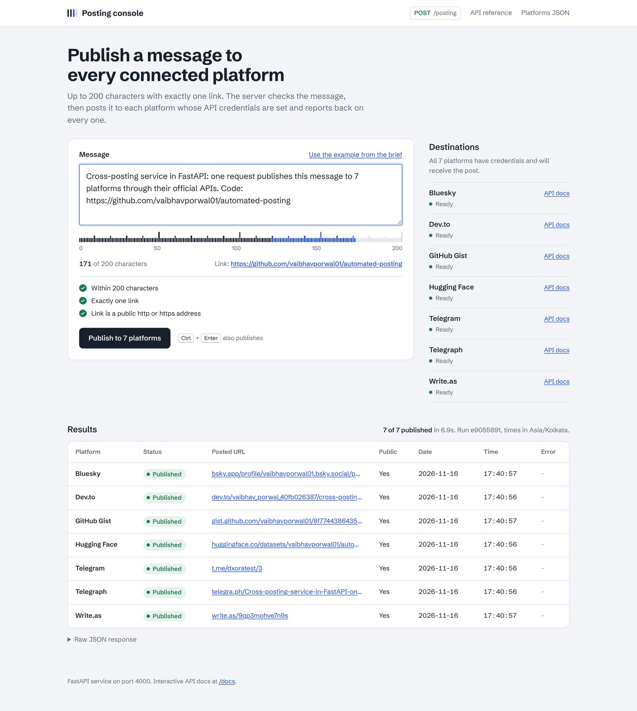
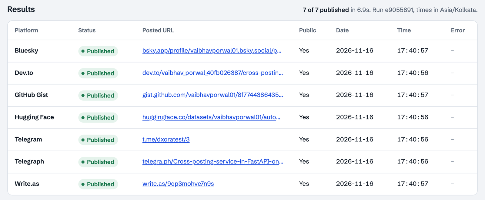
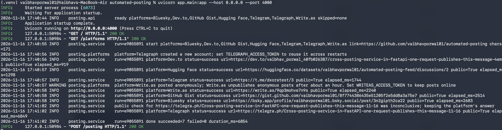
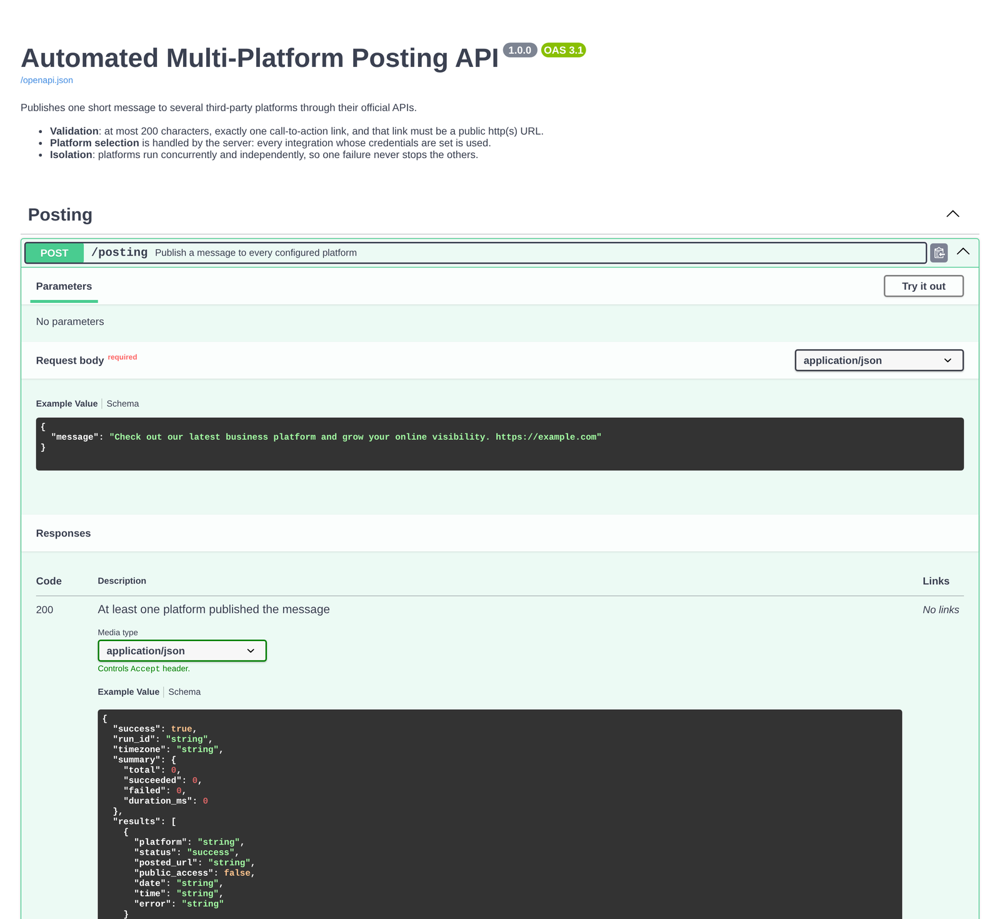
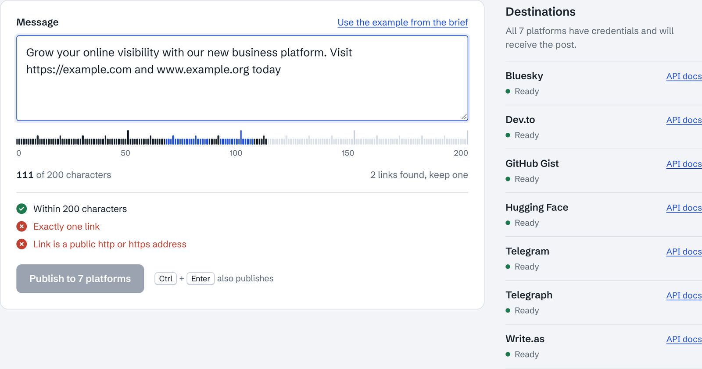

# Automated Multi-Platform Posting System

A FastAPI service that takes one short message and publishes it on **7 third-party platforms** through their official APIs. It has a single REST endpoint, `POST /posting`, plus a small web console for writing posts and reading the results.

- **Validation:** at most 200 characters, exactly one call-to-action link, and that link must be a public `http(s)` URL
- **Platform selection** happens on the server. Every platform whose credentials are set receives the post.
- **Isolation:** platforms run concurrently and independently, with timeouts and a retry. One failure never stops the others.
- **Results** for each platform: status, posted URL, public access, date, time and error. Public access is verified by opening the URL without credentials.



---

## Contents

- [Live run](#live-run)
- [Platforms](#platforms)
- [Requirements checklist](#requirements-checklist)
- [Quick start](#quick-start)
- [API](#api)
- [Sample requests and responses](#sample-requests-and-responses)
- [How it works](#how-it-works)
- [Project structure](#project-structure)
- [Configuration](#configuration)
- [Error handling](#error-handling)
- [Tests](#tests)
- [Logs and run records](#logs-and-run-records)
- [Security](#security)
- [Adding a platform](#adding-a-platform)

---

## Live run

On 16 November 2026 one request published this message (171 characters) to all 7 platforms in 6.9 seconds:

> Cross-posting service in FastAPI: one request publishes this message to 7 platforms through their official APIs. Code: https://github.com/vaibhavporwal01/automated-posting

| Platform | Status | Posted URL | Public | Date | Time (IST) |
|---|---|---|---|---|---|
| Bluesky | success | [bsky.app/profile/vaibhavporwal01.bsky.social/post/3n2gipth2ca22](https://bsky.app/profile/vaibhavporwal01.bsky.social/post/3n2gipth2ca22) | Yes | 2026-11-16 | 17:40:57 |
| Dev.to | success | [dev.to/vaibhav_porwal_40fb026387/cross-posting-service-...-4emi](https://dev.to/vaibhav_porwal_40fb026387/cross-posting-service-in-fastapi-one-request-publishes-this-message-4emi) | Yes | 2026-11-16 | 17:40:56 |
| GitHub Gist | success | [gist.github.com/vaibhavporwal01/8f7744386435e51205f2e5dd8a3a75e7](https://gist.github.com/vaibhavporwal01/8f7744386435e51205f2e5dd8a3a75e7) | Yes | 2026-11-16 | 17:40:57 |
| Hugging Face | success | [huggingface.co/datasets/vaibhavporwal01/automated-posting-feed/discussions/2](https://huggingface.co/datasets/vaibhavporwal01/automated-posting-feed/discussions/2) | Yes | 2026-11-16 | 17:40:56 |
| Telegram | success | [t.me/dxoratest/3](https://t.me/dxoratest/3) | Yes | 2026-11-16 | 17:40:56 |
| Telegraph | success | [telegra.ph/Cross-posting-service-in-FastAPI-...-11-16](https://telegra.ph/Cross-posting-service-in-FastAPI-one-request-publishes-this-message-11-16) | Yes | 2026-11-16 | 17:40:56 |
| Write.as | success | [write.as/9qp3mohve7n9s](https://write.as/9qp3mohve7n9s) | Yes | 2026-11-16 | 17:40:57 |

The full response is in [`docs/sample-response.json`](docs/sample-response.json) and the server log is in [`docs/sample-run.log`](docs/sample-run.log).

Two notes on those links:

- **Write.as** unpublishes anonymous posts after about an hour, so that link may no longer open. The integration posts anonymously by default so it works with zero setup. Set `WRITEAS_ACCESS_TOKEN` to post under an account and keep posts online. The server logs a warning whenever it posts anonymously.
- **Telegraph** pages are public, but some Indian ISPs block `telegra.ph`. The page opens normally from other networks. On a blocked network the public-access check times out, and the service then keeps the platform's own answer rather than marking the post private (see [Error handling](#error-handling)).

| Results in the console, captured on the machine that ran it | Server log for the same run |
|---|---|
|  |  |

---

## Platforms

Each platform was chosen because it has an official, documented write API, a free account, and publicly viewable posts. Together they cover social networks, developer publishing, messaging and an LLM platform.

| Platform | Kind | API call used | Auth | Official docs |
|---|---|---|---|---|
| **Bluesky** | Social network | `com.atproto.server.createSession`, then `com.atproto.repo.createRecord` (`app.bsky.feed.post`) | Handle and app password | [docs.bsky.app](https://docs.bsky.app/docs/advanced-guides/posts) |
| **Dev.to** | Developer blogging (Forem) | `POST /api/articles` with `published: true` | `api-key` header | [developers.forem.com](https://developers.forem.com/api/v1#tag/articles/operation/createArticle) |
| **GitHub Gist** | Developer publishing | `POST /gists` with `public: true` | Token with `gist` scope | [docs.github.com](https://docs.github.com/en/rest/gists/gists#create-a-gist) |
| **Hugging Face** | LLM and ML hub | `POST /api/{repo_type}s/{repo_id}/discussions`. The repo is created on first use. | Write token | [huggingface.co/docs](https://huggingface.co/docs/hub/api) |
| **Telegram** | Messaging, public channel | Bot API `sendMessage` | Bot token, and the bot is an admin of the channel | [core.telegram.org](https://core.telegram.org/bots/api#sendmessage) |
| **Telegraph** | Anonymous publishing | `createAccount` (once), then `createPage` | None. A token is created automatically. | [telegra.ph/api](https://telegra.ph/api) |
| **Write.as** | Minimal blogging | `POST /api/posts` | None (anonymous) or an optional token | [developers.write.as](https://developers.write.as/docs/api/) |

Platform-specific details the integrations handle:

- **Bluesky** links only become clickable through a *facet*, and facet offsets are counted in **UTF-8 bytes**, not characters. The integration computes byte offsets, so text with emoji or accented letters still links correctly.
- **Telegram** returns a public `t.me/<channel>/<id>` link for public channels. For a private channel it returns a `t.me/c/...` link and reports `public_access: false`.
- **Hugging Face** looks up the username, creates a public dataset repo (`automated-posting-feed`) if it is missing, and caches that setup for the life of the process.
- **Dev.to** tags are normalised to the Forem rules: at most 4, lowercase and alphanumeric.
- **Titles.** Platforms that need one (Dev.to, Telegraph, Gist, Hugging Face, Write.as) get a headline taken from the message. The link is removed and the text is cut at a word boundary.

---

## Requirements checklist

| Requirement from the brief | Where it is handled |
|---|---|
| FastAPI app with `POST http://localhost:4000/posting` | [`app/main.py`](app/main.py) |
| Request body `{"message": "..."}` | `PostRequest` in [`app/schemas.py`](app/schemas.py) |
| Message at most 200 characters | [`app/validation.py`](app/validation.py), `message_too_long` |
| Exactly one CTA link | `missing_link` / `multiple_links`. Links with or without a scheme (`www.`) are counted, so a second link cannot slip through. |
| Validate the URL | `invalid_url`: http/https only, a real domain or public IP, no credentials, valid port |
| Platform selection handled internally | `select_platforms()` in [`app/services/posting_service.py`](app/services/posting_service.py). A request that sends a `platforms` field is rejected. |
| Appropriate validation errors | `422` with a consistent JSON error body ([sample](#validation-errors)) |
| At least 5 platforms, researched and integrated | 7 platforms in [`app/platforms/`](app/platforms) |
| Automatic posting, each platform independent | `asyncio.gather` over isolated tasks, each with its own timeout and error capture |
| Continue when one platform fails | Every exception becomes a `failed` result. Tested in `test_one_failure_does_not_stop_the_others`. |
| Platform, status, posted URL, public access, date, time, error | `PlatformResult` in [`app/schemas.py`](app/schemas.py) |
| Python 3, FastAPI, Uvicorn, Pydantic, HTTPX | [`requirements.txt`](requirements.txt) |
| Credentials in environment variables | [`app/config.py`](app/config.py) (pydantic-settings) and [`.env.example`](.env.example) |
| Swagger docs at `/docs` | Built in, with request examples and documented error responses |
| Suggested structure, including `tests/test_posting.py` | Followed and extended (see [Project structure](#project-structure)) |
| README, sample requests and responses, screenshots or logs | This file, [`docs/`](docs) |
| No secrets committed | `.env` is git-ignored. Only `.env.example` with empty values is tracked. |

---

## Quick start

Requires Python 3.9 or newer.

```bash
git clone https://github.com/vaibhavporwal01/automated-posting.git
cd automated-posting

python3 -m venv .venv
source .venv/bin/activate          # Windows: .venv\Scripts\activate
pip install -r requirements.txt

cp .env.example .env               # then fill in the keys you have
uvicorn app.main:app --host 0.0.0.0 --port 4000
```

- Web console: http://localhost:4000
- Swagger UI: http://localhost:4000/docs
- Platform status: http://localhost:4000/platforms

Telegraph and Write.as need no keys, so the service can post right away. Each other platform switches on as soon as its keys are present in `.env`:

| Platform | How to get the credentials |
|---|---|
| GitHub Gist | https://github.com/settings/tokens/new?scopes=gist → `GITHUB_TOKEN` |
| Dev.to | https://dev.to/settings/extensions → DEV Community API Keys → `DEVTO_API_KEY` |
| Hugging Face | https://huggingface.co/settings/tokens, type **Write** → `HF_TOKEN` |
| Telegram | Create a bot with [@BotFather](https://t.me/BotFather) → `TELEGRAM_BOT_TOKEN`. Create a public channel, add the bot as an admin, and set `TELEGRAM_CHAT_ID=@channel_username`. |
| Bluesky | bsky.app → Settings → Privacy and security → App passwords → `BLUESKY_HANDLE` and `BLUESKY_APP_PASSWORD` |

---

## API

### `POST /posting`

```json
{ "message": "Check out our latest business platform and grow your online visibility. https://example.com" }
```

| Status | Meaning |
|---|---|
| `200` | At least one platform published the message |
| `422` | The message failed validation, or the body is not valid JSON |
| `502` | Every selected platform failed. The body still lists each error. |
| `503` | No platform is configured |

Response fields:

| Field | Description |
|---|---|
| `success` | `true` when at least one platform published |
| `run_id` | Short id that also appears on every log line for this request |
| `timezone` | Zone used for `date` and `time` (default `Asia/Kolkata`) |
| `summary` | `total`, `succeeded`, `failed`, `duration_ms` |
| `results[]` | One entry per platform: `platform`, `status` (`success` / `failed`), `posted_url`, `public_access`, `date` (`YYYY-MM-DD`), `time` (`HH:MM:SS`), `error` |
| `skipped[]` | Platforms left out because their credentials are missing, with the reason |

### Other endpoints

| Method | Path | Purpose |
|---|---|---|
| `GET` | `/` | Web console |
| `GET` | `/platforms` | Every integration, whether it is configured, and which settings are missing. Never returns secret values. |
| `GET` | `/health` | Liveness check |
| `GET` | `/docs` | Swagger UI |



---

## Sample requests and responses

### Successful post

```bash
curl -X POST http://localhost:4000/posting \
  -H "Content-Type: application/json" \
  -d '{"message": "Cross-posting service in FastAPI: one request publishes this message to 7 platforms through their official APIs. Code: https://github.com/vaibhavporwal01/automated-posting"}'
```

```json
{
  "success": true,
  "run_id": "e9055891",
  "timezone": "Asia/Kolkata",
  "summary": { "total": 7, "succeeded": 7, "failed": 0, "duration_ms": 6854 },
  "results": [
    {
      "platform": "Bluesky",
      "status": "success",
      "posted_url": "https://bsky.app/profile/vaibhavporwal01.bsky.social/post/3n2gipth2ca22",
      "public_access": true,
      "date": "2026-11-16",
      "time": "17:40:57",
      "error": null
    },
    {
      "platform": "Dev.to",
      "status": "success",
      "posted_url": "https://dev.to/vaibhav_porwal_40fb026387/cross-posting-service-in-fastapi-one-request-publishes-this-message-4emi",
      "public_access": true,
      "date": "2026-11-16",
      "time": "17:40:56",
      "error": null
    }
  ],
  "skipped": []
}
```

The other five entries are omitted here. The complete response is in [`docs/sample-response.json`](docs/sample-response.json).

### A platform that fails

A failure never stops the other platforms. It appears as its own entry:

```json
{
  "platform": "GitHub Gist",
  "status": "failed",
  "posted_url": null,
  "public_access": false,
  "date": null,
  "time": null,
  "error": "Authentication failed (HTTP 401): Bad credentials"
}
```

### Validation errors

Every validation error has the same shape. `error.message` is ready to show to a user, and `details[].code` is stable for programs to check.

```bash
curl -X POST http://localhost:4000/posting -H "Content-Type: application/json" \
  -d '{"message": "Grow your online visibility with our new business platform. Visit https://example.com and https://example.org today"}'
```

```json
{
  "success": false,
  "error": {
    "code": "validation_error",
    "message": "The message must include exactly one call-to-action link (found 2).",
    "details": [
      {
        "field": "message",
        "code": "multiple_links",
        "message": "The message must include exactly one call-to-action link (found 2)."
      }
    ]
  }
}
```

| Input | `details[].code` | `error.message` |
|---|---|---|
| 210 characters | `message_too_long` | The message must not exceed 200 characters (got 210). |
| No link | `missing_link` | The message must include exactly one call-to-action link (found none). |
| Two links | `multiple_links` | The message must include exactly one call-to-action link (found 2). |
| `https://localhost:3000` | `invalid_url` | The link 'https://localhost:3000' needs a full domain name such as example.com. |
| `ftp://files.example.com` | `invalid_url` | The link 'ftp://files.example.com' uses an unsupported scheme. Use http:// or https://. |
| `https://192.168.1.10` | `invalid_url` | The link 'https://192.168.1.10' points to a private address and would not work for readers. |
| Empty or spaces only | `empty_message` | The message must not be empty. |
| `{"message": 42}` | `invalid_type` | The message must be a string. |
| `{}` | `missing` | The 'message' field is required. |
| Extra `platforms` field | `extra_forbidden` | Unknown field 'platforms'. Platforms are selected by the server, so send only 'message'. |
| Malformed JSON | `json_invalid` | The request body is not valid JSON. |

The console runs the same rules as you type, so mistakes show up before you publish. The server stays the source of truth.



---

## How it works

```text
POST /posting
   │
   ├─ PostRequest (Pydantic) ─► validation.py
   │      trim → length ≤ 200 → find links → exactly one → URL checks
   │      failure → 422 with a readable error
   │
   ├─ PostingService.publish()
   │      Post(text, link, title)
   │      asyncio.gather(one task per platform)
   │        ├─ Bluesky.publish()      ┐
   │        ├─ DevTo.publish()        │ each task:
   │        ├─ GitHubGist.publish()   │  • its own time budget
   │        ├─ HuggingFace.publish()  │  • 1 retry on timeout, connection error, 429, 5xx
   │        ├─ Telegram.publish()     │  • any error → "failed" result with a message
   │        ├─ Telegraph.publish()    │  • success → anonymous GET to confirm public access
   │        └─ WriteAs.publish()      ┘  • timestamp in the configured timezone
   │
   └─ PostingResponse  →  200 (≥1 success) or 502 (all failed)
          also saved to logs/runs/<time>-<run_id>.json
```

Design choices:

- **One shared `httpx.AsyncClient`** is created in the app lifespan and reused, so connections are pooled and closed cleanly on shutdown.
- **Platforms are plain classes** with a common base (`BasePlatform`) that provides the retrying `request()` helper, JSON parsing and HTTP-status-to-message mapping. Each integration only describes its own API.
- **Selection is configuration-driven.** A platform is used when its required settings are present. `ENABLED_PLATFORMS` can narrow the list without code changes.
- **Public access is measured, not assumed.** After a successful post the service opens the URL with no credentials. A 2xx response means public, and 401/404/410 means not public. An inconclusive check (timeout, 5xx, bot protection) keeps the platform's own answer, so a slow network never marks a real post as private.

---

## Project structure

```text
automated-posting/
├── app/
│   ├── main.py                  # FastAPI app, routes, error handlers, lifespan
│   ├── config.py                # Settings from environment / .env
│   ├── schemas.py               # Request and response models
│   ├── validation.py            # Message, link and URL rules
│   ├── logging_config.py        # Console + rotating file logs
│   ├── platforms/
│   │   ├── __init__.py          # Registry of integrations
│   │   ├── base.py              # BasePlatform, retries, error mapping, titles
│   │   ├── bluesky.py
│   │   ├── devto.py
│   │   ├── github_gist.py
│   │   ├── huggingface.py
│   │   ├── telegram.py
│   │   ├── telegraph.py
│   │   └── writeas.py
│   ├── services/
│   │   └── posting_service.py   # Selection, concurrent fan-out, results, run records
│   └── static/                  # Web console (HTML, CSS, JS, self-hosted fonts)
├── tests/
│   ├── conftest.py
│   ├── test_validation.py       # Length, link count, URL rules
│   ├── test_platforms.py        # Each integration against mocked HTTP
│   └── test_posting.py          # Service isolation and the HTTP API
├── docs/
│   ├── sample-response.json     # Real response from the live run
│   ├── sample-run.log           # Server log of the live runs
│   └── screenshots/
├── .env.example
├── requirements.txt
├── requirements-dev.txt
├── pyproject.toml               # pytest settings
└── README.md
```

---

## Configuration

All settings come from environment variables or `.env`. Empty values are ignored.

| Variable | Default | Purpose |
|---|---|---|
| `TIMEZONE` | `Asia/Kolkata` | Zone for result dates and times |
| `REQUEST_TIMEOUT` | `15` | Seconds per HTTP call |
| `MAX_RETRIES` | `1` | Retries for timeouts, connection errors, 429 and 5xx (0 to 3) |
| `VERIFY_PUBLIC_ACCESS` | `true` | Open each posted URL without credentials to confirm it is public |
| `ENABLED_PLATFORMS` | all | Comma-separated keys: `bluesky,devto,github_gist,huggingface,telegram,telegraph,writeas` |
| `LOG_LEVEL` | `INFO` | Log verbosity |
| `LOG_FILE` | `logs/posting.log` | Rotating log file |
| `RUNS_DIR` | `logs/runs` | One JSON record per request |
| `GITHUB_TOKEN` | | GitHub Gist |
| `DEVTO_API_KEY`, `DEVTO_TAGS` | | Dev.to |
| `HF_TOKEN`, `HF_REPO_ID`, `HF_REPO_TYPE` | | Hugging Face (repo defaults to `<user>/automated-posting-feed`, type `dataset`) |
| `TELEGRAM_BOT_TOKEN`, `TELEGRAM_CHAT_ID` | | Telegram |
| `BLUESKY_HANDLE`, `BLUESKY_APP_PASSWORD`, `BLUESKY_SERVICE` | | Bluesky |
| `TELEGRAPH_ACCESS_TOKEN`, `TELEGRAPH_AUTHOR_NAME` | | Telegraph (optional) |
| `WRITEAS_ACCESS_TOKEN` | | Write.as (optional, keeps posts online) |

---

## Error handling

| Situation | What the API returns |
|---|---|
| Invalid input | `422` with `error.code = validation_error` and a specific `details[].code` |
| One platform rejects the request | That platform's entry is `failed`, with the platform's own message, e.g. `Authentication failed (HTTP 401): Bad credentials` |
| Timeout or dropped connection | Retried once, then `Request timed out after 15s (2 attempt(s)).` or `Could not reach dev.to: ConnectError (2 attempt(s)).` |
| Rate limit or 5xx | Retried once (honouring `Retry-After` up to 5 s), then reported |
| Bug inside an integration | Caught and reported as `Unexpected error: ...`. The other platforms are unaffected and the trace is logged. |
| Every platform failed | `502` with the full results list |
| No platform configured | `503` with a hint to fill in `.env` |
| Anything unexpected in the app | `500` with a generic message. Details go to the log only. |

---

## Tests

```bash
pip install -r requirements-dev.txt
pytest -q
```

There are 77 tests and none of them touch the network. HTTP calls are mocked with `respx`. They cover:

- **Validation:** boundaries at 200 and 201 characters, zero, one and two links, trailing punctuation, and a range of valid and invalid URLs
- **Each integration:** the exact request it sends (headers, body, Bluesky byte offsets, Telegraph nodes), how it parses the response into a URL, and how it maps errors
- **Shared behaviour:** retry after a 503, timeout and connection-error messages
- **Service:** one success, one rejection and one crash in the same run, plus all-failed, the public-access check, and run records
- **API:** status codes 200, 422, 502 and 503, every validation error code, and that `/platforms` never leaks a secret

The suite passes on Python 3.9, 3.10 and 3.13.

---

## Logs and run records

Every request gets a `run_id` that appears on each related log line:

```text
2026-11-16 17:40:55 INFO    posting.service    run=e9055891 start platforms=Bluesky,Dev.to,GitHub Gist,Hugging Face,Telegram,Telegraph,Write.as link=https://github.com/vaibhavporwal01/automated-posting chars=171
2026-11-16 17:40:56 INFO    posting.service    run=e9055891 platform=Dev.to status=success url=https://dev.to/vaibhav_porwal_40fb026387/cross-posting-service-in-fastapi-one-request-publishes-this-message-4emi public=True elapsed_ms=919
2026-11-16 17:40:57 WARNING posting.platforms  platform=Write.as posted anonymously; Write.as unpublishes anonymous posts after about an hour. Set WRITEAS_ACCESS_TOKEN to keep posts online
2026-11-16 17:40:58 INFO    posting.service    run=e9055891 platform=Bluesky status=success url=https://bsky.app/profile/vaibhavporwal01.bsky.social/post/3n2gipth2ca22 public=True elapsed_ms=2683
2026-11-16 17:41:02 INFO    posting.service    run=e9055891 done succeeded=7 failed=0 duration_ms=6854
```

The full log of both live runs is in [`docs/sample-run.log`](docs/sample-run.log). Each response is also written to `logs/runs/<timestamp>-<run_id>.json` together with the original message, which gives an audit trail of what went where.

---

## Security

- Credentials are read only from environment variables or `.env`. `.env` is git-ignored, and `.env.example` holds empty placeholders.
- Secrets are stored as Pydantic `SecretStr`, so they never appear in reprs, logs or API responses. `/platforms` reports only *which* settings are missing.
- The Telegram Bot API puts the token in the URL path, so the `httpx` request logger is turned down to `WARNING` to keep URLs out of the logs. Connection errors report only the host name.
- Links that point to localhost, private IP ranges or contain `user:password@` are rejected.
- The console's fonts are self-hosted (SIL Open Font License). The page makes no third-party requests.

---

## Adding a platform

1. Create `app/platforms/<name>.py` with a subclass of `BasePlatform`. Set `key`, `name`, `docs_url` and `required_settings`, and implement `async def publish(self, post) -> PublishedPost`.
2. Add its settings to `app/config.py` and `.env.example`.
3. Append the class to `PLATFORM_CLASSES` in `app/platforms/__init__.py`.
4. Add a mocked test in `tests/test_platforms.py`.

Selection, retries, error mapping, public-access checks, timestamps, logging and the console pick it up automatically.
